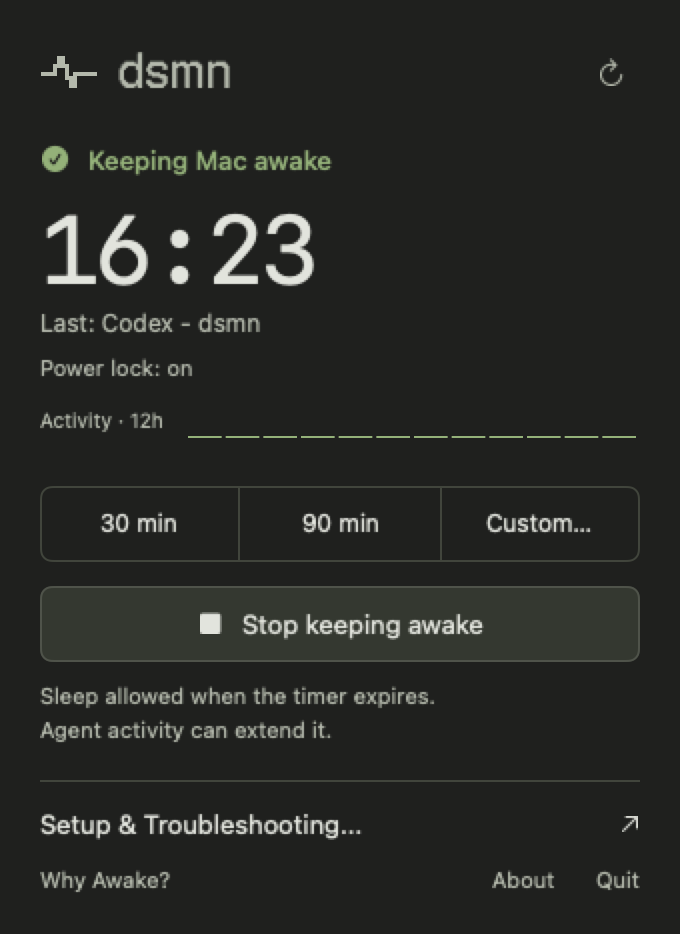
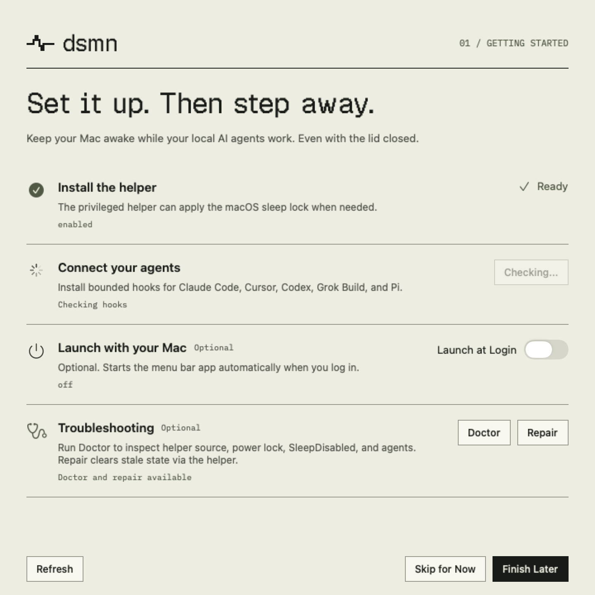

# Native app identity

Reference: [dsmn-website PR #5](https://github.com/nomdelasociete/dsmn-website/pull/5),
commit `b3aa932`. The maintainer selected the compact timer panel from that PR
as the app's primary menu bar surface.

The 28 × 20 heartbeat is the exact square-capped SVG path from the website.
`DSMNIdentity` expands that stroke and shares it between the wordmark, template
menu bar icon, and generated app icon. `Resources/dsmn-pulse.svg` retains the
source artwork. The `.icns` uses the website's stepped paper tile with transparent
macOS margins. Regenerate it with `./scripts/generate_app_icon.sh [output.icns]`.
The previous crown documents remain in `docs/` as historical source files.

Geist Pixel Square and IBM Plex Mono were converted losslessly from the PR's
WOFF2 files into desktop TTF containers. Both OFL licenses ship in Resources.
SwiftPM and Xcode builds load the same assets; font registration is process scoped.

## Surfaces

- The panel follows the website's charcoal app preview. It shows real helper
  state, a seconds countdown, recent trigger activity, and direct actions.
- Onboarding, setup, Why Awake, Doctor, feedback, and About share paper surfaces,
  pixel headings, flat ruled sections, and sage controls. Dark mode uses charcoal
  surfaces and warm light text. Orange is reserved for attention and focus.
- Diagnostics remain selectable. Feedback diagnostics remain opt-in. Helper
  updates remain advisory, with Later available. Hook removal stays in About
  with a separate confirmation. Existing Stop & Quit handling is retained.
- Fonts, button feedback, and window layouts are local; there is no web view,
  remote font request, or continuous decorative animation.

## Review images

These are native SwiftUI views rendered with isolated sample state. The setup
guide shows the hook-checking state; it does not contact or configure agents.





To regenerate light/dark previews, including idle/warning panels and other windows:

```sh
DSMN_DESIGN_SNAPSHOT_DIR=/tmp/dsmn-design swift test --filter BrandPresentationTests
```

Offscreen previews disable view tasks. AppKit rendering is used because SwiftUI's
ImageRenderer omits native scroll views. These images supplement live interaction
checks; they do not assert that a rendered view can be clicked.

## Validation

Run `swift test`, `xcodegen generate`, the Debug Xcode build, bundle verification,
and `./scripts/e2e_menu_setup.sh`. The interaction script selects the test process
by PID and exercises heartbeat → panel → setup → Refresh. It checks that Stop
is present and enabled, and that Setup Guide and Done remain reachable.
It temporarily closes the installed menu app to avoid duplicate bundle IDs in
Accessibility, then reopens it. Its preference overrides are process scoped.

Brand tests check font/icon packaging, active/idle template distinction, a helper
that has not acquired its lock, and countdown expiry without another status poll.
The existing helper release, fallback, hook, quit, and setup tests remain required.
